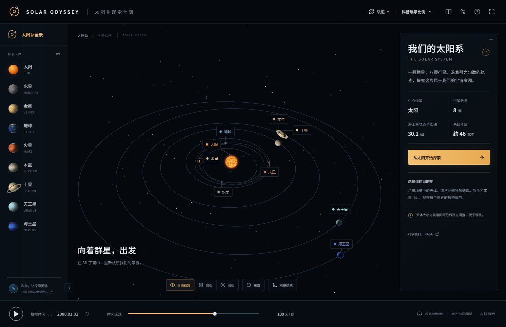
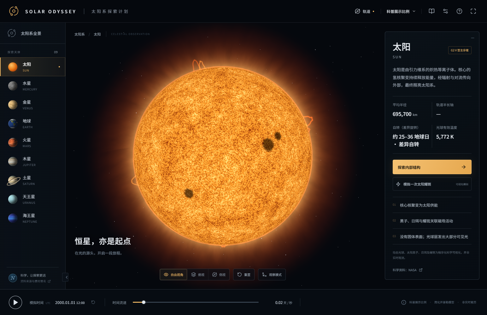
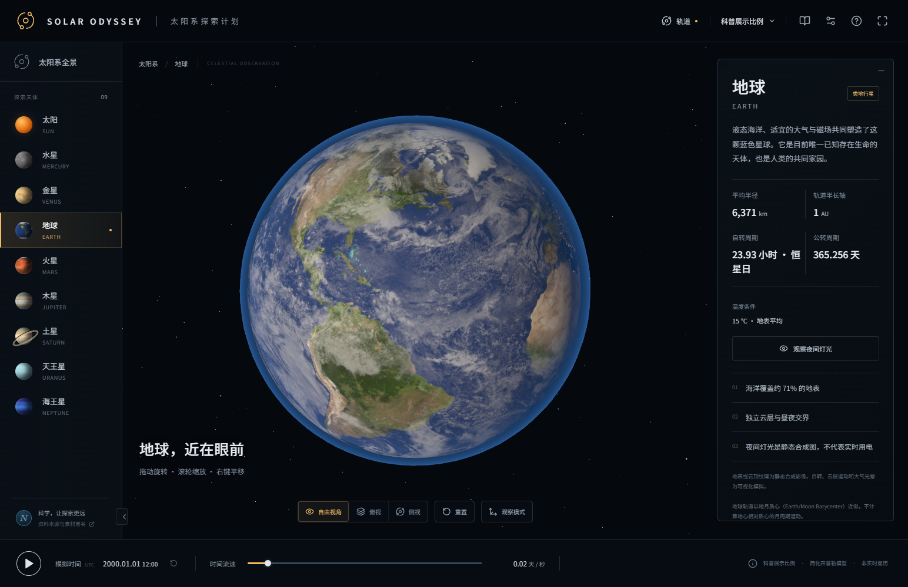
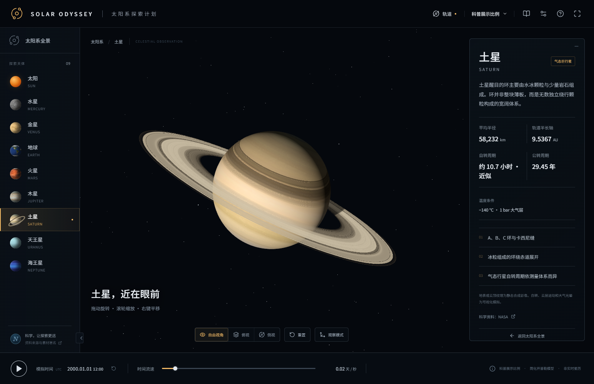

# Solar Odyssey · 太阳系探索计划

在 DeepSeek Harness 侧栏打开太阳系，观察太阳与八大行星的运动，进入太阳七层剖面，跟随四步课程了解能量如何向外传递。游戏界面为中文，渲染与纹理资源随包提供，游玩无需模型 API。



## 实机画面

### 太阳



### 地球



### 土星



## 安装到 DSH

从源码构建需要 Node.js 22.12+ 和 npm。运行游戏的浏览器或桌面环境需支持 WebGL 2。

```sh
git clone https://github.com/Activer007/solar-odyssey-dsh.git
cd solar-odyssey-dsh
npm ci
npm pack
```

在 DSH「插件」页安装生成的 `local-solar-odyssey-1.2.0.tgz`，再从侧栏打开「太阳系探索计划」（英文外壳显示 Solar Odyssey）。若已安装同名旧版，可先移除旧版再安装。若安装结果为 `restart-required`，重启当前 profile。以下命令适用于 DSH Web CLI。

```sh
dsh plugin --profile web add ./local-solar-odyssey-1.2.0.tgz
dsh --profile web
```

使用 Creator Mode 开发时，可以先运行 `npm run build:dsh`，再将项目绝对目录传给 `plugin_manager` 的 `install_bundle`。

## 怎么探索

1. 从全景点击天体或标签进入特写。旋转、缩放和切换「科普展示比例」与「真实物理比例」，可以比较轨道与天体尺寸。
2. 选择太阳，打开「探索内部结构」，进入四步「能量的旅程」。第 4 步用暖橙光球、红色色球薄边、紫色过渡区与渐淡的白色日冕羽流区分结构。剖面支持选层、展开和调节外层透明度。
3. 从右上角打开「探索任务」，完成太阳课程、地球夜面和土星观察，解锁科普问答。进度和画质保存在当前运行环境的本地存储中。

场景获得焦点后，`Space` 暂停或恢复，`Home` 返回全景，`1`–`9` 快选太阳和行星。全景与特写共用模拟日期和暂停状态，切换时会恢复各自选过的流速。

| 视角 | 默认流速 | 可调范围 |
| --- | ---: | ---: |
| 太阳系全景 | 100 天／秒 | 1–1000 天／秒 |
| 天体特写和太阳剖面 | 0.02 天／秒 | 0.01–100 天／秒 |

流速单位为每个实际秒推进的模拟天数。特写显示 UTC 时分，便于观察日内变化。

## 本地开发

```sh
npm run dev            # 在浏览器独立预览
npm run build:preview  # 构建独立站点到 dist/
npm run build:dsh      # 构建 DSH 插件到 lib/
```

- [DSH 面板](src/dsh-panel.js) 向宿主注册侧栏入口和主面板。打开时通过 Client loader 延迟加载游戏。
- [游戏入口](src/dsh-game.tsx) 在 Shadow DOM 内挂载独立的 React 19 与 React Three Fiber 场景，切出面板时释放游戏根和 WebGL 资源。
- [场景](src/scene/)、[模拟](src/simulation/)和[科普数据](src/data/)分别负责 Three.js 渲染、时间与轨道、天体与课程资料。
- [DSH 构建脚本](scripts/build-dsh.mjs) 生成 Client factory、游戏模块和按内容版本化的纹理，并为缺少 `require.asset` 的早期运行时提供随包纹理回退。

## 验证

```sh
npm test
npm run assets:verify
npx playwright install chromium
npm run test:e2e -- tests/e2e/simulation-clock.spec.ts tests/e2e/solar-lesson.spec.ts
```

`1.2.0` 已在 DSH Web `0.2.2-rc.1` 中验证安装、标签选中、分视角流速和时间连续性。验证完整探索任务时，可依次完成太阳课程、地球夜面和土星观察，再答题并刷新页面检查进度。

## 科学说明与素材署名

公转采用固定 J2000 根数和简化开普勒模型，日期用于教学演示。太阳剖面的配色、薄层厚度、粒子和时间尺度经过教学调整。天体纹理由 Solar System Scope / INOVE 基于 NASA 图像和高程资料制作，采用 [CC BY 4.0](https://creativecommons.org/licenses/by/4.0/)，在游戏中经过球面映射和光照处理。逐文件来源与科学依据见 [资料来源](docs/SOURCES.md) 和 [素材清单](docs/assets-manifest.json)。
